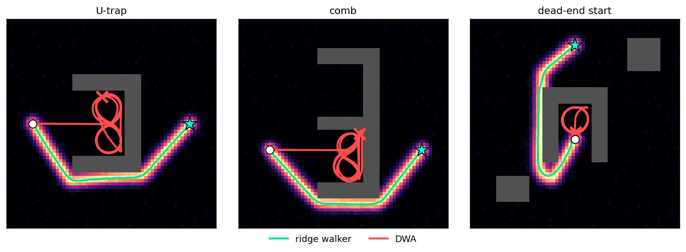
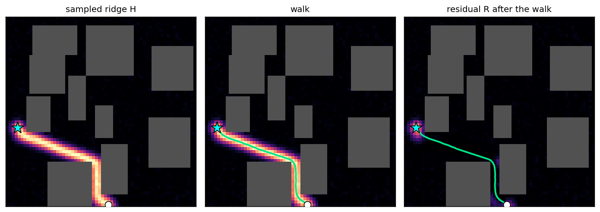
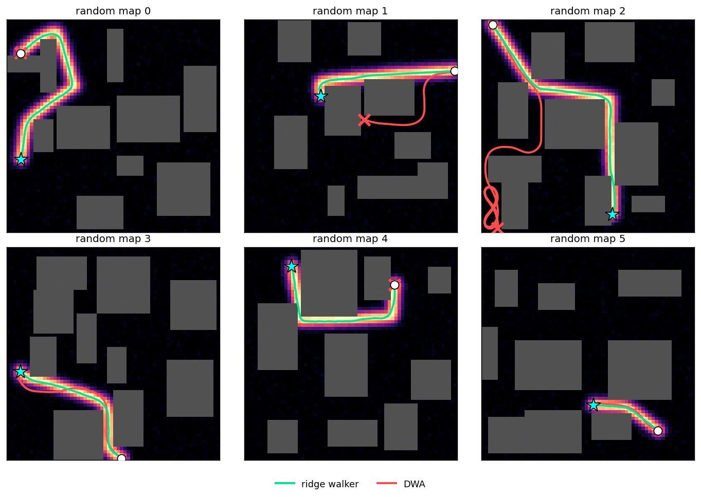

# RidgeFlow

**A DWA with nothing to tune.** A flow-matching model paints a ridge over the map in one shot.
A dynamic-window walker then follows it. The walker has no goal term, no cost weights and no
constants to tune. Because it follows a route drawn over the whole map, it gets out of dead
ends that trap a classic DWA.

<p align="center"></p>

The same maps given to a classic DWA (red), which may also reverse. DWA only knows the
direction to the goal, so it drives into the pocket and circles there. The walker (green) follows the route the model drew.

## Method

A query goes through three stages: **sample** a ridge heatmap, **project** it so that it
certainly connects start and goal, and **walk** it.

The model takes an occupancy grid and two endpoints and returns a heatmap `H`: a Gaussian ridge
of width σ<sub>H</sub> laid along a feasible route. It is trained with rectified flow on RRT*
demonstrations and sampled in 4 steps. The occupancy grid is conservative: a cell is blocked
when any part of it overlaps an obstacle, so a path through free cells never touches one and no
padding is needed. Training adds three things to the flow loss:

- **Geodesic targets** (`--geodesic-target`): the ridge's distance to the demonstration is
  measured through free cells only, so a ridge never leaks through a thin wall.
- **Gap loss** (`--gap-weight 100`): on the one-step estimate of the clean heatmap, find the
  cheapest start-goal route under `1 - log H` and lift the cells of that route where `H < 0.5`,
  weighted by `1 - t`. The route is the sample's own, so the loss closes breaks without pulling
  samples towards the demonstration's homotopy class (`ridgeflow/training/gap.py`).
- **Symmetry augmentation** (`--augment`): one of the 8 rotations and reflections of the square
  per query, applied to the map, the endpoints and the target alike.

The **projection** (`ridgeflow.routes.project`) is the L2 projection of `H` onto the heatmaps
in which some free start-goal route has `H ≥ 0.5` on every cell: find the cheapest route under
the cell cost `(0.5 − H)₊² + ε` and raise its cells that are below 0.5 to 0.5. A heatmap that
already connects comes back unchanged, so the projection only touches the rare broken sample and
needs no check first. The walker then reads ridge energy only near that route.

The walker is a DWA whose objective is the ridge itself. It keeps a residual `R`, which starts
as `H`. Each step it fans candidates `c` over the half-plane ahead, drops those whose segment
hits an obstacle (the feasible set `F`), and moves to the candidate that explains the most
remaining energy. It then subtracts its own footprint:

```math
x_{k+1} = \arg\max_{c \in F_k} \langle R_k, \Phi_c \rangle,
\qquad
R_{k+1} = \max\left(R_k - a\,\Phi_{x_{k+1}},\ 0\right),
\qquad
\Phi_c(z) = \exp\left(-\frac{\lVert z - c \rVert^2}{2\sigma_H^2}\right)
```

Ridge the walker has already covered stops attracting it, so the energy left ahead sets the
direction. There is no goal term and nothing to oscillate back to. Once the goal is within one
ridge width and the segment to it is free, the walker connects to the goal. It remembers where
the ridge forked: when every candidate ahead is blocked, or the energy ahead falls to the
truncation level (a dead-end branch), it returns to the last fork and takes the next branch.

<p align="center"></p>

Every constant comes from the model or the grid:

| constant | value | from |
|---|---|---|
| footprint σ | σ<sub>H</sub> = 1.5 px | the ridge width the model was trained on |
| amplitude `a` | δ / (σ√(2π)) | atoms one step apart add up to exactly a unit ridge |
| step δ | 1 px | the grid |
| cone | ±90° | the half-plane ahead (the rear only when everything ahead is blocked) |
| window | ⌈σ√(2 ln 10³) + ½⌉ = 7 | truncation error below 0.1% |

## Random maps

1000 maps drawn from the training distribution (7 to 10 boxes, straight line blocked). Every
method plans on the same conservative raster; a path counts when it reaches the goal and clears
every obstacle rectangle exactly.

| method | weights to tune | success |
|---|---|---|
| **ridge walker + projection** | **none** | **100.0%** |
| ridge walker | none | 99.9% |
| DWA, best of 60 settings | heading, clearance, speed, horizon | 50.4% |

The walker's candidates, collision filter and argmax are those of a DWA. The only change is the
objective: DWA scores the direction to the goal, clearance and speed, and the weights between
them decide whether it works at all. The walker scores the ridge energy it would explain, and
that energy already encodes a route around the obstacles. Without the projection the walker
fails only when the sampled ridge is broken and no branch it can backtrack to reaches the goal;
the projection closes exactly those breaks.

<p align="center"></p>

The DWA baseline follows PythonRobotics and may reverse at up to half its top speed. Its result
depends heavily on its weights. We searched 60 settings on 100 held-out maps (without reversing,
on the earlier raster padded by one cell), and the benchmark uses the best one. A selection:

| heading | clearance | speed | horizon | success |
|---|---|---|---|---|
| 0.08 | 0.30 | 3.0 | 0.6 s | **53%** |
| 0.03 | 0.10 | 1.0 | 0.6 s | 51% |
| 0.15 | 0.10 | 1.0 | 1.0 s | 31% |
| 0.15 | 0.03 | 1.0 | 1.0 s | 20% |
| 0.15 | 0.10 | 1.0 | 2.0 s | 18% |
| 0.50 | 0.10 | 1.0 | 1.0 s | 5% |
| | | | worst of 60 | 0% |

## What each part buys

Each row retrains the model without one part (300 epochs, same data and seed) and samples
1000 random maps 4 times each. *Connected*: share of raw samples in which a free route has
`H ≥ 0.5` all along; *gap cells*: cells below 0.5 on the ridge geodesic, per sample; *walker*:
success of the backtracking walker on the raw and on the projected sample.

| model | connected | gap cells | walker | walker + projection |
|---|---|---|---|---|
| **full** | **99.58%** | **0.19** | **99.90%** | **100.00%** |
| without gap loss | 98.15% | 0.59 | 99.48% | 99.98% |
| without augmentation | 99.55% | 0.19 | 99.88% | 99.98% |
| without geodesic targets | 99.15% | 0.46 | 99.93% | 99.98% |
| none of the three | 95.28% | 1.41 | 98.85% | 99.90% |

Without the gap loss a sample has three times as many gap cells, without geodesic targets 2.4
times as many; augmentation mostly buys variety here, as route diversity (1 − IoU between
draws) drops from 0.32 to 0.28 without it. The backtracking walker on its own lifts the greedy walker
from 99.5% to 99.9% on the full model.

**Grid search guided by the heatmap (TMP64).** The same recipe on 64×64 tiled maps, with the
heatmap guiding FOCAL search (w = 2) instead of a walker: 1044 test queries × 3 seeds, one draw
each. A* expands 487 nodes per query on average.

| model | connected | expansions saved vs A* | path cost / optimal |
|---|---|---|---|
| **full** | **99.2%** | **78.4%** | **1.004** |
| without gap loss | 98.5% | 77.3% | 1.006 |
| without augmentation | 95.2% | 72.5% | 1.021 |
| without geodesic targets | 99.0% | 78.3% | 1.005 |
| none of the three | 75.7% | 54.2% | 1.055 |

On these maps augmentation matters most, and the three together lift connectivity from 76% to
99%.

**Speed.** One query on an RTX 5080, median of 100 queries, in ms. K draws are sampled in
one batch, and each is projected and walked:

| | sample | project | walk | total |
|---|---|---|---|---|
| K = 1 | 8.6 | 2.4 | 0.5 | 11.6 |
| K = 1, `fast=True` | 2.4 | 2.3 | 0.5 | **5.1** |
| K = 8 | 17.7 | 2.8 | 2.3 | 22.7 |
| K = 8, `fast=True` | 7.8 | 2.7 | 2.1 | **12.6** |

`RidgeModel(checkpoint, fast=True)` runs the UNet in bf16 and compiles the 4-step loop with
`torch.compile` (call `model.warmup()` once; it compiles for about a minute). Over 1000 maps ×
4 draws it leaves walker success (99.9%) and path length unchanged. The walker is compiled with
numba and walks a batch on CPU threads.

## Run

```bash
pip install -e ".[fast]"                 # numba for the compiled walker
python examples/demo.py                  # the figures above
python examples/benchmark.py             # the random-maps table
python examples/make_dataset.py          # RRT* demonstrations
python examples/train.py --dataset DATA.npy --geodesic-target --gap-weight 100 --augment
```

The experiments behind the tables are in `experiments/`, run from the repository root as
modules, e.g. `python -m experiments.rrt_ablation full=checkpoints/ridgeflow_rrt64.pt --json
outputs/ablation/rrt.json` (component ablation), `python -m experiments.tmp64_eval`
(TMP64), `python -m experiments.fast_pipeline` (speed). Shared helpers live in
`experiments/common.py`.
